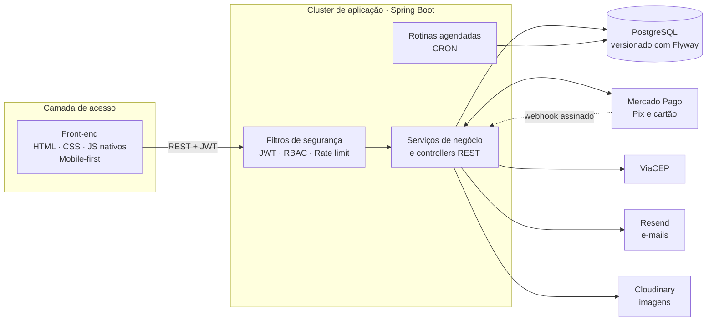
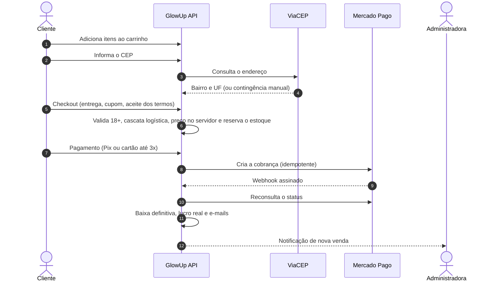
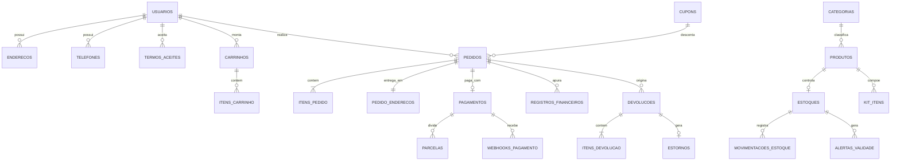

<div align="center">


<br/>

**Um e-commerce completo, com gestão interna embutida, construído sob medida para resolver a rotina de uma revendedora de cosméticos de verdade.**

<br/>

[](https://github.com/SEU-USUARIO/glowup-fullstack/actions/workflows/ci.yml)


[Sobre](#-sobre-o-projeto) ·
[Funcionalidades](#-funcionalidades) ·
[Regras de negócio](#-regras-de-negócio-que-moldaram-o-sistema) ·
[Arquitetura](#-arquitetura) ·
[Como rodar](#-como-rodar-localmente) ·
[Equipe](#-equipe)

</div>

---

## 🎓 Contexto do projeto

> **Este é um trabalho acadêmico, mas o problema é real.**
>
> O GlowUp foi desenvolvido como **Projeto Integrador de Sistemas Computacionais** do Centro Universitário Euroamericano (**UNIEURO**), nas turmas ADS04M1 e SI04M1 dos cursos de Análise e Desenvolvimento de Sistemas e Sistemas de Informação, sob orientação do **Prof. Paulo Augusto** (2026).
>
> Em vez de um sistema fictício, o grupo trabalhou com uma **cliente real**: a revendedora **Domingas**, que vende produtos Natura, O Boticário, Eudora e Avon. Os requisitos, as regras de negócio e as restrições do sistema vêm da operação dela.

---

## 💄 Sobre o projeto

O **GlowUp** tem dois papéis ao mesmo tempo:

- **Para a administradora (Domingas):** ferramenta de gestão interna que automatiza a rotina da revenda, com controle de estoque, cálculo do **lucro real** de cada venda, logística regional e alertas de validade e reposição.
- **Para as clientes:** vitrine online com cadastro seguro, carrinho, checkout com Pix e cartão, acompanhamento de pedidos e devoluções.

Revender cosméticos tem regras próprias: produtos de **pronta-entrega** (estoque físico) convivem com itens **sob encomenda** (pedidos pela revista do fornecedor), a entrega só atende **dois bairros**, o produto lacrado é condição para devolução e as taxas do gateway comem a margem. O GlowUp traduz cada uma dessas situações em regra de sistema, com testes automatizados.

### Números do projeto

| | |
|:---:|:---|
| **80+** | endpoints REST documentados com Swagger/OpenAPI |
| **200** | métodos de teste automatizados em 35 classes |
| **30+** | tabelas versionadas em **23 migrations** Flyway |
| **25** | telas em HTML, CSS e JavaScript nativos |
| **50** | produtos carregados no catálogo inicial (carga via migration) |

---

## ✨ Funcionalidades

### 🛍️ Para a cliente

| Módulo | O que oferece |
|---|---|
| **Conta e segurança** | Cadastro sem CPF, trava de maioridade (18+), senha forte, login com JWT, recuperação de acesso por código (OTP) enviado por e-mail |
| **Meu perfil** | Edição de dados, múltiplos telefones e endereços (com principal), troca de senha e exclusão lógica da conta |
| **Vitrine** | Busca por nome, filtro por categoria, ordenação por preço e paginação |
| **Carrinho** | Persistido no servidor, subtotal em tempo real e alerta quando o estoque ou o preço muda |
| **Checkout** | Cálculo de frete, validação de CEP via ViaCEP, cupons de desconto e aceite dos termos de uso |
| **Pagamento** | Pix (com QR Code) ou cartão em até 3x, com os juros do parcelamento repassados à compradora |
| **Pós-venda** | Acompanhamento do status do pedido, cancelamento enquanto aguarda pagamento e devolução em até 7 dias |
| **Retirada no local** | Link de WhatsApp com mensagem pronta para combinar a retirada com a revendedora |

### 👩‍💼 Para a administradora

| Módulo | O que oferece |
|---|---|
| **Painel e métricas** | Dashboard com vendas consolidadas por período |
| **Lucro real** | Cálculo por pedido: valor total − custo de fábrica − taxas do gateway, congelado na aprovação do pagamento |
| **Pedidos** | Lista completa e transição de status (`Pago → Em separação → Enviado → Entregue`) |
| **Catálogo** | CRUD de produtos, categorias e kits (de fábrica ou montados), com inativação em vez de exclusão |
| **Estoque** | Entradas e ajustes com auditoria de cada movimentação |
| **Cupons** | Cadastro com validade, valor mínimo e limite de uso |
| **Devoluções** | Análise, conferência do lacre e recebimento com estorno e reposição automáticos ao estoque |
| **CRM de reposição** | Sugere o momento de contatar a cliente com base na data da compra e no tempo médio de uso do cosmético |
| **Alertas de validade** | Aviso de produtos de pronta-entrega que vencem em até 25 dias |
| **Modo manutenção** | Interruptor para tirar a loja do ar com uma tela de aviso |

---

## 📐 Regras de negócio que moldaram o sistema

Estas regras saíram do levantamento com a cliente e estão implementadas no back-end, não só na interface.

| Regra | Como o sistema trata |
|---|---|
| **Entrega restrita** (RN03) | Frete fixo de R$ 10,00 apenas para **Itapoã e Paranoá**. Qualquer outra região só tem **retirada grátis**. A trava é em cascata (país → UF → bairro) e o servidor rejeita o que a tela deixar passar |
| **Carrinho misto** (RN03) | Com itens de pronta-entrega e sob encomenda, o checkout unifica a entrega e mostra o **prazo mais longo** |
| **Taxas e juros** (RN02) | A vitrine mostra o preço oficial. As taxas do gateway são **absorvidas pela revendedora**; só os juros do parcelamento (máximo de 3x) vão para a compradora. O Pix não tem custo extra |
| **Estoque por modalidade** (RNF02) | Controle rígido de quantidade só em **pronta-entrega**. Itens sob encomenda não têm saldo |
| **Reserva e baixa de estoque** (RN04) | Reserva atômica no checkout. A baixa definitiva só acontece quando o webhook do gateway aprova o pagamento, e webhooks repetidos são ignorados |
| **Sem "fiado"** (RN04) | Só Pix e cartão. Pagamento na entrega e venda a prazo estão bloqueados |
| **Lucro real** (RN05) | A rentabilidade deduz custo de fábrica e taxas. Sem esses dados, o pedido aparece como "Dados insuficientes" e fica fora das somas |
| **Resiliência no pagamento** (RN06) | Se o Mercado Pago cair, o carrinho **não é esvaziado** e a cliente recebe uma mensagem amigável |
| **Maioridade** (RN07) | O servidor calcula a idade pela data de nascimento e bloqueia menores de 18 anos |
| **Promoções** (RN08) | Rotina diária à meia-noite devolve ao preço base os produtos cuja promoção expirou, sem alterar o lucro de pedidos já registrados |
| **Devolução** (RN01 / RD03) | Prazo de 7 dias, produto lacrado, estorno e reposição de estoque no recebimento. Cobre devolução parcial e direito de arrependimento (art. 49 do CDC) |
| **Exclusão lógica** (RNF02) | Nenhum registro das tabelas principais é apagado fisicamente, o que preserva o histórico financeiro. Todas as chaves estrangeiras usam `ON DELETE RESTRICT` |

---

## 🔒 Segurança e LGPD

O projeto foi pensado sob o princípio de **Security by Design**.

- **Sem CPF no banco.** A coleta se limita ao necessário (nome, e-mail, telefone, data de nascimento e endereço), conforme o princípio da minimização de dados da LGPD (art. 6º, III). Quando o CPF é exigido no pagamento com cartão, ele segue direto ao gateway e **nunca é persistido nem logado**.
- **Termos de uso auditáveis.** O aceite é gravado com data, hora e versão do documento, vinculado ao usuário.
- **Autenticação robusta.** Access token JWT de curta duração (30 min) e refresh token com **rotação a cada uso**, armazenado apenas como hash SHA-256. Se um token já usado reaparecer, todas as sessões da conta são encerradas. Trocar a senha invalida os tokens anteriores.
- **Controle de acesso por perfil (RBAC).** Rotas `/api/admin/**` exigem o perfil `ADMIN`. Senhas com hash BCrypt e validação de complexidade.
- **Senha provisória da administradora.** No primeiro acesso, a API só libera a troca de senha até que ela seja feita.
- **Proteção contra abuso.** Limite de requisições por IP (Bucket4j) em login, cadastro, checkout, pagamento e consulta de CEP, mais bloqueio temporário por conta após falhas seguidas de login.
- **Webhooks confiáveis.** Assinatura validada, eventos deduplicados e status sempre reconsultado na API do Mercado Pago. O valor e a referência devolvidos são conferidos com o pedido.
- **Chaves fora do código.** Todos os segredos vêm de variáveis de ambiente. Em produção, a API **se recusa a subir** com segredo JWT fraco, CORS aberto ou remetente de e-mail de demonstração.
- **Dependências em dia.** Dependabot abre pull requests semanais com atualizações e correções de segurança.

---

## 🏗️ Arquitetura

Arquitetura em camadas (N-Tier) hospedada em nuvem como PaaS (**Render**, sem Docker), com front-end, back-end e persistência separados.



### Fluxo de compra



### Rotinas automáticas

| Horário (America/Sao_Paulo) | Rotina |
|---|---|
| A cada 5 min | Encerra Pix expirado e cancela pedidos sem pagamento, liberando o estoque |
| 00:00 | Reverte promoções expiradas ao preço base |
| 08:00 | Gera alertas de validade (até 25 dias) |
| 08:30 | CRM: calcula sugestões de reposição |

---

## 🧰 Stack

| Camada | Tecnologias |
|---|---|
| **Back-end** | Java 21, Spring Boot, Spring Security, Spring Data JPA, Bean Validation, Lombok |
| **Banco de dados** | PostgreSQL, Flyway (migrations versionadas) |
| **Autenticação** | JWT (jjwt), refresh token com rotação, BCrypt, RBAC |
| **Documentação da API** | OpenAPI / Swagger UI (springdoc), coleções Postman |
| **Front-end** | HTML5, CSS3 e JavaScript nativos, design responsivo mobile-first |
| **Integrações** | Mercado Pago (pagamentos e webhooks), ViaCEP (endereços), Resend (e-mail transacional), Cloudinary (imagens) |
| **Qualidade** | JUnit e Spring Test, GitHub Actions (CI com PostgreSQL 16), Dependabot |
| **Infraestrutura** | Render (PaaS) |
| **Gestão do projeto** | Git Flow, Pull Requests e quadro Kanban (Planner) |

---

## 🗄️ Modelo de dados

Visão simplificada das entidades centrais. O DER completo e o dicionário de dados estão na [documentação do projeto](#-documentação).



---

## 📁 Estrutura do repositório

```
glowup-fullstack/
├── api/                          # Back-end (Spring Boot)
│   ├── src/main/java/com/glowup/api/
│   │   ├── config/               # Segurança, rate limit, CORS, Swagger, manutenção
│   │   ├── controller/           # Endpoints REST (cliente e administradora)
│   │   ├── service/              # Regras de negócio, gateway, jobs e e-mail
│   │   ├── domain/ · model/      # Entidades e enums
│   │   ├── repository/           # Acesso a dados (JPA)
│   │   ├── dto/                  # Contratos de entrada e saída
│   │   └── exception/            # Tratamento centralizado de erros
│   ├── src/main/resources/db/migration/   # Migrations Flyway (V1 a V24)
│   ├── src/test/                 # Testes automatizados
│   ├── scripts/                  # Utilitários SQL (limpeza de dados de teste, senha admin)
│   └── .env.example              # Modelo das variáveis de ambiente
├── frontend/                     # Front-end (HTML, CSS e JS nativos)
│   ├── css/                      # base · layouts · components · pages
│   ├── js/core/                  # api, store, ui, layout, config
│   └── js/pages/                 # um script por tela
├── docs/                         # Documentação técnica e coleções Postman
└── .github/                      # CI (GitHub Actions) e Dependabot
```

---

## 🚀 Como rodar localmente

### Pré-requisitos

- **Java 21**
- **PostgreSQL** (local, com um banco chamado `glowup`)
- Um servidor HTTP estático para o front-end (Live Server do VS Code ou `python -m http.server`)
- Opcional: contas de teste no **Mercado Pago**, **Resend** e **Cloudinary** para exercitar pagamentos, e-mails e upload de imagens

### 1. Clone o repositório

```bash
git clone https://github.com/SEU-USUARIO/glowup-fullstack.git
cd glowup-fullstack
```

### 2. Crie o banco de dados

```sql
CREATE DATABASE glowup;
```

### 3. Configure as variáveis de ambiente

```bash
cd api
cp .env.example .env
```

Edite o `.env` e preencha, no mínimo:

| Variável | Para que serve |
|---|---|
| `DB_URL`, `DB_USER`, `DB_PASS` | Conexão com o PostgreSQL |
| `JWT_SECRET` | Segredo de assinatura dos tokens. Gere com `python -c "import secrets; print(secrets.token_hex(32))"` |
| `ADMIN_EMAIL`, `ADMIN_SENHA_INICIAL` | Conta da administradora, criada na primeira subida |
| `SPRING_PROFILES_ACTIVE` | Use `local` no ambiente de desenvolvimento |

As integrações (`MP_*`, `RESEND_*`, `CLOUDINARY_*`) são necessárias para pagamentos, e-mails e upload de imagens. O passo a passo de cada credencial está em [`docs/CONFIGURACAO_AMBIENTE.md`](docs/CONFIGURACAO_AMBIENTE.md).

> ⚠️ **Nunca versione o `.env`.** Ele já está no `.gitignore`.

### 4. Suba a API

```bash
./rodar-local.sh        # Linux, macOS ou Git Bash
rodar-local.cmd         # Windows (CMD)
```

Na primeira execução o Flyway cria todas as tabelas e carrega o catálogo inicial. A API sobe em `http://localhost:8080`. Com `SWAGGER_ENABLED=true` no `.env`, a documentação interativa fica disponível em `/swagger-ui.html`.

### 5. Suba o front-end

Em outro terminal, sirva a pasta `frontend/` por HTTP (não abra o `index.html` direto como `file://`):

```bash
cd frontend
python -m http.server 5500
```

Acesse `http://localhost:5500`. O endereço da API é configurado em `frontend/js/core/config.js` (`apiBaseUrl`).

Para entrar como administradora, use o `ADMIN_EMAIL` e o `ADMIN_SENHA_INICIAL` definidos no `.env`. Clientes se cadastram pela própria tela.

---

## ✅ Testes e qualidade

```bash
cd api
./mvnw verify
```

- **200 testes automatizados** cobrem serviços de negócio, segurança, rate limit, autorização de rotas, webhooks, devoluções, conciliação de pagamentos e mais.
- O pipeline de **CI (GitHub Actions)** compila e roda toda a suíte a cada push e pull request, com um **PostgreSQL 16 real**, o que pega erros como tabela sem migration.
- O **Dependabot** mantém as dependências Maven e as Actions atualizadas.

---

## 📚 Documentação

| Documento | Conteúdo |
|---|---|
| [**Documentação do Projeto Integrador (PDF)**](docs/GlowUp_Projeto_Integrador.pdf) | Documento acadêmico completo: requisitos (RF, RNF, RN, RD), casos de uso, estórias de usuário e de sistema, arquitetura, diagramas de classes e de sequência, DER, dicionário de dados, protótipos de interface e Kanban |
| [`docs/BACKEND_COMPLETO.md`](docs/BACKEND_COMPLETO.md) | O que o back-end cobre, fluxos, decisões de projeto e contratos da API |
| [`docs/CONFIGURACAO_AMBIENTE.md`](docs/CONFIGURACAO_AMBIENTE.md) | Variáveis de ambiente, execução local, e-mail e Mercado Pago |
| [`docs/INTEGRACAO_FINANCEIRA.md`](docs/INTEGRACAO_FINANCEIRA.md) | Pagamentos, webhooks, lucro real e devoluções |
| [`docs/GlowUp-API.postman_collection.json`](docs/GlowUp-API.postman_collection.json) | Coleção Postman com todas as rotas |
| [`docs/GlowUp-Financeiro.postman_collection.json`](docs/GlowUp-Financeiro.postman_collection.json) | Cenários de teste de pagamento e devolução |

---

## 👥 Equipe

O GlowUp foi construído por cinco pessoas, cada uma com frentes bem definidas. Veja abaixo quem fez o quê.

### Visão geral

| Integrante | GitHub | Back-end | Front-end | Banco de dados | Documentação |
|---|---|:---:|:---:|:---:|:---:|
| **Ana Luiza Fernandes Novaes** | [@SEU-USUARIO](https://github.com/SEU-USUARIO) | ● | ◐ | | |
| **Yasmin Gomes de Matos** | [@USUARIO-YASMIN](https://github.com/USUARIO-YASMIN) | ● | | | ● |
| **Emerson Júnior de Santana Oliveira Leite** | [@USUARIO-EMERSON](https://github.com/USUARIO-EMERSON) | | | ● | ● |
| **Sthefanny Ramos Parrini** | [@USUARIO-STHEFANNY](https://github.com/USUARIO-STHEFANNY) | | ● | | ◐ |
| **Marcelo Leitão e Silva Filho** | [@USUARIO-MARCELO](https://github.com/USUARIO-MARCELO) | | | ◐ | ● |

● responsável principal · ◐ apoio

### Quem fez o quê

**Ana Luiza** · [@SEU-USUARIO](https://github.com/SEU-USUARIO)
- **Back-end**, em dupla com a Yasmin: configuração de ambiente e chaves de API, autenticação (JWT e RBAC) e a integração financeira com o Mercado Pago (pagamentos, webhooks, pós-venda, dashboard e lucro real).
- Apoio no **desenvolvimento do front-end**.

**Yasmin** · [@USUARIO-YASMIN](https://github.com/USUARIO-YASMIN)
- **Back-end**, em dupla com a Ana.
- Participação ativa na **documentação** do projeto.

**Emerson** · [@USUARIO-EMERSON](https://github.com/USUARIO-EMERSON)
- **Banco de dados completo**: toda a modelagem (DER e dicionário de dados).
- **Todos os diagramas da documentação**: casos de uso, arquitetura, classes e sequência.
- Participação ativa na **documentação** do projeto.

**Sthefanny** · [@USUARIO-STHEFANNY](https://github.com/USUARIO-STHEFANNY)
- **Front-end**: interfaces da loja e do painel da administradora.
- Apoio na **documentação**: mapeamento dos requisitos de domínio e levantamento das exigências da **LGPD**.

**Marcelo** · [@USUARIO-MARCELO](https://github.com/USUARIO-MARCELO)
- Participação ativa na **documentação** do projeto.
- Forte apoio na **modelagem e construção do banco de dados**.

---

## 🧭 Gestão do projeto

O grupo organizou o trabalho em um **quadro Kanban** (Microsoft Planner) com ciclos semanais entre agosto e outubro de 2026, e adotou **Git Flow** com branches por tarefa (`feature/`, `fix/`, `chore/`, `docs/`) e **Pull Requests** obrigatórios. Os registros do Kanban estão na documentação do projeto.

---

<div align="center">

**Feito com 💗 por estudantes de Análise e Desenvolvimento de Sistemas e Sistemas de Informação**

Projeto Integrador de Sistemas Computacionais · UNIEURO · 2026

</div>
