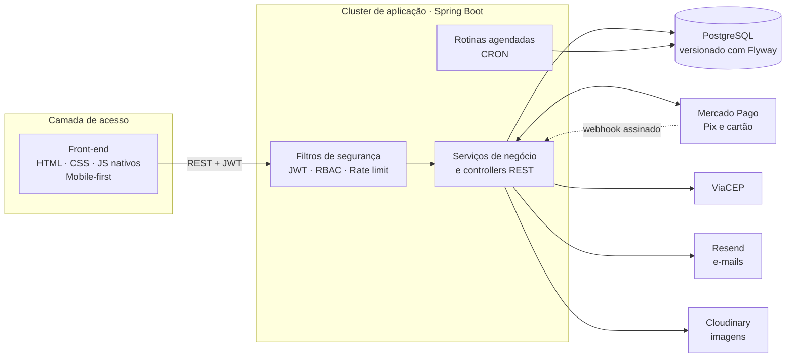
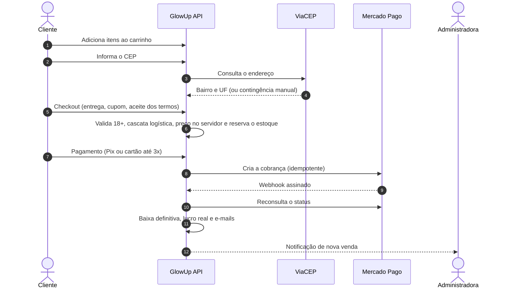
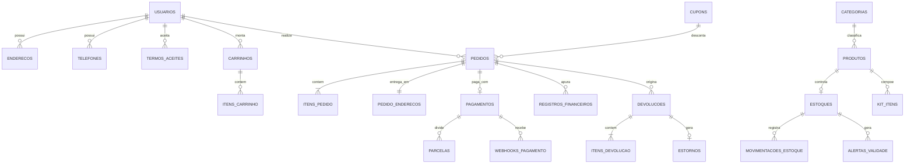

<div align="center">


### ✨ Um e-commerce completo, com gestão interna embutida,<br/>construído sob medida para a rotina de uma revendedora de cosméticos de verdade.

<!-- BADGES DE TECNOLOGIA -->


<p>
  <a href="#sobre-o-projeto">📖 <b>Sobre</b></a> &nbsp;•&nbsp;
  <a href="#funcionalidades">🚀 <b>Funcionalidades</b></a> &nbsp;•&nbsp;
  <a href="#regras-de-negócio">⚖️ <b>Regras de negócio</b></a> &nbsp;•&nbsp;
  <a href="#segurança-e-lgpd">🛡️ <b>Segurança</b></a> &nbsp;•&nbsp;
  <a href="#arquitetura">🏗️ <b>Arquitetura</b></a> &nbsp;•&nbsp;
  <a href="#como-rodar-localmente">💻 <b>Como rodar</b></a> &nbsp;•&nbsp;
  <a href="#equipe">👥 <b>Equipe</b></a>
</p>

<!-- CARDS DE ESTATÍSTICAS -->
<table>
  <tr>
    <td align="center" width="180">
      <h2>🚀 80+</h2>
      <sub><b>ENDPOINTS REST</b><br/>documentados no Swagger</sub>
    </td>
    <td align="center" width="180">
      <h2>🧪 200</h2>
      <sub><b>TESTES AUTOMATIZADOS</b><br/>em 35 classes</sub>
    </td>
    <td align="center" width="180">
      <h2>🗄️ 23</h2>
      <sub><b>MIGRATIONS FLYWAY</b><br/>30+ tabelas versionadas</sub>
    </td>
    <td align="center" width="180">
      <h2>📱 25</h2>
      <sub><b>TELAS RESPONSIVAS</b><br/>mobile-first</sub>
    </td>
  </tr>
</table>

</div>

---

## Sobre o projeto

> [!IMPORTANT]  
> **Este é um trabalho acadêmico, mas o problema é real.**
> O GlowUp nasceu como **Projeto Integrador de Sistemas Computacionais** do Centro Universitário Euroamericano (**UNIEURO**), turmas ADS04M1 e SI04M1, sob orientação do **Prof. Paulo Augusto** (2026). Em vez de inventar um sistema fictício, o grupo trabalhou com uma **cliente real**: a revendedora **Domingas**, que vende Natura, O Boticário, Eudora e Avon. Requisitos, regras e restrições vêm da operação dela.

O sistema cumpre dois papéis ao mesmo tempo:

| Módulo | Para quem | O que entrega |
|:--|:--|:--|
| 👑 **Gestão** | A administradora | Controle de estoque, **lucro real** de cada venda, logística regional e alertas de validade e reposição |
| 🛍️ **Vitrine** | As clientes | Cadastro seguro, carrinho, checkout com Pix e cartão, acompanhamento de pedidos e devoluções |

Revender cosméticos tem regras próprias: **pronta-entrega** convive com **sob encomenda**, a entrega atende só **dois bairros**, produto lacrado é condição de devolução e as taxas do gateway comem a margem. O GlowUp transforma cada uma dessas situações em regra de sistema, validada no servidor e coberta por testes.

### O que torna o projeto diferente

- 🎯 **Cliente real, requisitos reais.** Cada regra de negócio saiu de um levantamento com quem vive a operação.
- 💰 **Dinheiro tratado com seriedade.** Reserva atômica de estoque, pagamentos idempotentes e webhooks assinados, deduplicados e reconsultados no gateway.
- 🛡️ **Segurança desde o desenho.** JWT com rotação de refresh token, RBAC, rate limit e **zero CPF persistido** (LGPD).
- 📚 **Banco versionado e auditável.** Flyway, exclusão lógica e `ON DELETE RESTRICT` em todas as chaves estrangeiras.
- ✅ **Qualidade verificada.** CI no GitHub Actions rodando 200 testes contra um **PostgreSQL 16 real**.

---

## Funcionalidades

### 🛍️ Para a cliente

| Módulo | O que oferece |
|:--|:--|
| 🔐 **Conta e segurança** | Cadastro sem CPF, trava de maioridade (18+), senha forte, login com JWT e recuperação de acesso por código (OTP) por e-mail |
| 👤 **Meu perfil** | Edição de dados, múltiplos telefones e endereços, troca de senha e exclusão lógica da conta |
| 🏬 **Vitrine** | Busca por nome, filtro por categoria, ordenação por preço e paginação |
| 🛒 **Carrinho** | Persistido no servidor, subtotal em tempo real e alerta quando estoque ou preço mudam |
| 💳 **Checkout** | Frete, validação de CEP via ViaCEP, cupons de desconto e aceite dos termos de uso |
| 💸 **Pagamento** | Pix com QR Code ou cartão em até 3x, com juros do parcelamento repassados à compradora |
| 📦 **Pós-venda** | Status do pedido, cancelamento enquanto aguarda pagamento e devolução em até 7 dias |
| 📍 **Retirada no local** | Link de WhatsApp com mensagem pronta para combinar com a revendedora |

### 👑 Para a administradora

| Módulo | O que oferece |
|:--|:--|
| 📊 **Painel e métricas** | Dashboard com vendas consolidadas por período |
| 💵 **Lucro real** | Por pedido: valor total − custo de fábrica − taxas do gateway, congelado na aprovação do pagamento |
| 📋 **Pedidos** | Lista completa e transição de status (`Pago → Em separação → Enviado → Entregue`) |
| 🏷️ **Catálogo** | CRUD de produtos, categorias e kits (de fábrica ou montados), com inativação no lugar de exclusão |
| 📦 **Estoque** | Entradas e ajustes com auditoria de cada movimentação |
| 🎟️ **Cupons** | Validade, valor mínimo e limite de uso |
| 🔄 **Devoluções** | Análise, conferência do lacre e recebimento com estorno e reposição automáticos ao estoque |
| 📞 **CRM de reposição** | Sugere quando contatar a cliente, com base na data da compra e no tempo médio de uso do cosmético |
| ⏳ **Alertas de validade** | Aviso de produtos de pronta-entrega que vencem em até 25 dias |
| 🚧 **Modo manutenção** | Interruptor que tira a loja do ar com uma tela de aviso |

---

## Regras de negócio

Estas regras saíram do levantamento com a cliente e estão implementadas no **back-end**, não só na interface.

| Regra | Como o sistema trata |
|:--|:--|
| 🚚 **Entrega restrita** (RN03) | Frete fixo de R$ 10,00 apenas para **Itapoã e Paranoá**. Qualquer outra região só tem **retirada grátis**. A trava é em cascata (país → UF → bairro) e o servidor rejeita o que a tela deixar passar |
| 🛒 **Carrinho misto** (RN03) | Com itens de pronta-entrega e sob encomenda, o checkout unifica a entrega e mostra o **prazo mais longo** |
| 💸 **Taxas e juros** (RN02) | A vitrine mostra o preço oficial. As taxas do gateway são **absorvidas pela revendedora**; só os juros do parcelamento (máximo de 3x) vão para a compradora. Pix não tem custo extra |
| 📦 **Estoque por modalidade** (RNF02) | Controle rígido de quantidade só em **pronta-entrega**. Itens sob encomenda não têm saldo |
| ⚡ **Reserva e baixa de estoque** (RN04) | Reserva atômica no checkout. A baixa definitiva só ocorre quando o webhook aprova o pagamento, e webhooks repetidos são ignorados |
| 🚫 **Sem "fiado"** (RN04) | Só Pix e cartão. Pagamento na entrega e venda a prazo estão bloqueados |
| 💰 **Lucro real** (RN05) | Deduz custo de fábrica e taxas. Sem esses dados, o pedido aparece como "Dados insuficientes" e fica fora das somas |
| 🛡️ **Resiliência no pagamento** (RN06) | Se o Mercado Pago cair, o carrinho **não é esvaziado** e a cliente recebe uma mensagem amigável |
| 🔞 **Maioridade** (RN07) | O servidor calcula a idade pela data de nascimento e bloqueia menores de 18 anos |
| 🏷️ **Promoções** (RN08) | Rotina diária à meia-noite devolve ao preço base os produtos com promoção expirada, sem alterar o lucro de pedidos já registrados |
| 🔄 **Devolução** (RN01 / RD03) | Prazo de 7 dias, produto lacrado, estorno e reposição no recebimento. Cobre devolução parcial e direito de arrependimento (art. 49 do CDC) |
| 🗑️ **Exclusão lógica** (RNF02) | Nenhum registro das tabelas principais é apagado fisicamente, preservando o histórico financeiro |

---

## Segurança e LGPD

Projeto construído sob o princípio de **Security by Design**.

| Frente | O que foi feito |
|:--|:--|
| 👁️ **Minimização de dados** | **Sem CPF no banco** (LGPD, art. 6º, III). Quando o cartão exige CPF, ele segue direto ao gateway e nunca é persistido nem logado |
| 📝 **Termos auditáveis** | O aceite é gravado com data, hora e versão do documento, vinculado ao usuário |
| 🔑 **Autenticação** | Access token JWT de 30 min e refresh token com **rotação a cada uso**, guardado apenas como hash SHA-256. Se um token já usado reaparecer, todas as sessões da conta são encerradas. Trocar a senha invalida os tokens anteriores |
| 🛂 **Autorização (RBAC)** | Rotas `/api/admin/**` exigem o perfil `ADMIN`. Senhas com BCrypt e validação de complexidade |
| 🚪 **Primeiro acesso** | Com senha provisória, a API só libera a troca de senha até que ela seja feita |
| 🚦 **Proteção contra abuso** | Rate limit por IP (Bucket4j) em login, cadastro, checkout, pagamento e CEP, mais bloqueio temporário após falhas seguidas de login |
| 🪝 **Webhooks confiáveis** | Assinatura validada, eventos deduplicados e status sempre reconsultado no Mercado Pago, com valor e referência conferidos |
| 🤫 **Segredos fora do código** | Tudo vem de variáveis de ambiente. Em produção, a API **se recusa a subir** com segredo JWT fraco, CORS aberto ou remetente de e-mail de demonstração |
| 🔄 **Dependências em dia** | Dependabot abre pull requests semanais com atualizações e correções de segurança |

---

## Arquitetura

Arquitetura em camadas (N-Tier) com front-end, back-end e persistência separados.



### Fluxo de compra



### Rotinas automáticas

| Horário (America/Sao_Paulo) | Rotina |
|:--|:--|
| A cada 5 min | Encerra Pix expirado e cancela pedidos sem pagamento, liberando o estoque |
| 00:00 | Reverte promoções expiradas ao preço base |
| 08:00 | Gera alertas de validade (até 25 dias) |
| 08:30 | CRM: calcula sugestões de reposição |

---

## Stack

| Camada | Tecnologias |
|:--|:--|
| ⚙️ **Back-end** | `Java 21` `Spring Boot` `Spring Security` `Spring Data JPA` `Bean Validation` `Lombok` |
| 🗄️ **Banco de dados** | `PostgreSQL` `Flyway` |
| 🔐 **Autenticação** | `JWT (jjwt)` `Refresh token com rotação` `BCrypt` `RBAC` |
| 📚 **Documentação da API** | `OpenAPI / Swagger UI (springdoc)` `Postman` |
| 🎨 **Front-end** | `HTML5` `CSS3` `JavaScript nativo` `Mobile-first` |
| 🔌 **Integrações** | `Mercado Pago` `ViaCEP` `Resend` `Cloudinary` |
| 🧪 **Qualidade** | `JUnit` `Spring Test` `GitHub Actions (PostgreSQL 16)` `Dependabot` |
| 📋 **Gestão** | `Git Flow` `Pull Requests` `Kanban (Planner)` |

---

## Modelo de dados

Visão simplificada das entidades centrais. O DER completo e o dicionário de dados estão na [documentação do projeto](#-documentação).



---

## Estrutura do repositório

```
glowup-fullstack/
├── api/                          # Back-end (Spring Boot)
│   ├── src/main/java/com/glowup/api/
│   │   ├── config/               # Segurança, rate limit, CORS, Swagger, manutenção
│   │   ├── controller/           # Endpoints REST (cliente e administradora)
│   │   ├── service/              # Regras de negócio, gateway, jobs e e-mail
│   │   ├── domain/ · model/      # Entidades e enums
│   │   ├── repository/           # Acesso a dados (JPA)
│   │   ├── dto/                  # Contratos de entrada e saída
│   │   └── exception/            # Tratamento centralizado de erros
│   ├── src/main/resources/db/migration/   # Migrations Flyway
│   ├── src/test/                 # Testes automatizados
│   ├── scripts/                  # Utilitários SQL
│   └── .env.example              # Modelo das variáveis de ambiente
├── frontend/                     # Front-end (HTML, CSS e JS nativos)
│   ├── css/                      # base · layouts · components · pages
│   ├── js/core/                  # api, store, ui, layout, config
│   └── js/pages/                 # um script por tela
├── docs/                         # Documentação técnica e coleções Postman
└── .github/                      # CI (GitHub Actions) e Dependabot
```

---

## Como rodar localmente

**Pré-requisitos:** Java 21 · PostgreSQL (banco `glowup`) · um servidor HTTP estático para o front-end.
Opcional: contas de teste no Mercado Pago, Resend e Cloudinary para exercitar pagamentos, e-mails e imagens.

**1️⃣ Clone e crie o banco**

```bash
git clone https://github.com/SEU-USUARIO/glowup-fullstack.git
cd glowup-fullstack
```

```sql
CREATE DATABASE glowup;
```

**2️⃣ Configure as variáveis de ambiente**

```bash
cd api
cp .env.example .env
```

<details>
<summary><b>🔧 Variáveis mínimas do <code>.env</code></b></summary>

<br/>

| Variável | Para que serve |
|:--|:--|
| `DB_URL`, `DB_USER`, `DB_PASS` | Conexão com o PostgreSQL |
| `JWT_SECRET` | Segredo de assinatura dos tokens. Gere com `python -c "import secrets; print(secrets.token_hex(32))"` |
| `ADMIN_EMAIL`, `ADMIN_SENHA_INICIAL` | Conta da administradora, criada na primeira subida |
| `SPRING_PROFILES_ACTIVE` | Use `local` em desenvolvimento |

As integrações (`MP_*`, `RESEND_*`, `CLOUDINARY_*`) são necessárias para pagamentos, e-mails e upload de imagens. O passo a passo está em [`docs/CONFIGURACAO_AMBIENTE.md`](docs/CONFIGURACAO_AMBIENTE.md).

</details>

> [!WARNING]  
> **Nunca versione o `.env`.** Ele já está no `.gitignore`.

**3️⃣ Suba a API**

```bash
./rodar-local.sh        # Linux, macOS ou Git Bash
rodar-local.cmd         # Windows (CMD)
```

Na primeira execução o Flyway cria todas as tabelas e carrega o catálogo inicial de **50 produtos**. A API sobe em `http://localhost:8080`, e com `SWAGGER_ENABLED=true` a documentação interativa fica em `/swagger-ui.html`.

**4️⃣ Suba o front-end**

Em outro terminal, sirva a pasta `frontend/` por HTTP (não abra o `index.html` como `file://`):

```bash
cd frontend
python -m http.server 5500
```

Acesse `http://localhost:5500`. O endereço da API fica em `frontend/js/core/config.js` (`apiBaseUrl`). Para entrar como administradora, use o `ADMIN_EMAIL` e o `ADMIN_SENHA_INICIAL` do `.env`. Clientes se cadastram pela própria tela.

---

## Testes e qualidade

```bash
cd api
./mvnw verify
```

- 🧪 **200 testes automatizados** cobrem serviços de negócio, segurança, rate limit, autorização de rotas, webhooks, devoluções e conciliação de pagamentos.
- ⚙️ O **CI (GitHub Actions)** compila e roda toda a suíte a cada push e pull request contra um **PostgreSQL 16 real**, o que pega erros como tabela sem migration.
- 🤖 O **Dependabot** mantém dependências Maven e Actions atualizadas.

---

## Documentação

| Documento | Conteúdo |
|:--|:--|
| 📄 [**Documentação do Projeto Integrador (PDF)**](docs/GlowUp_Projeto_Integrador.pdf) | Requisitos (RF, RNF, RN, RD), casos de uso, estórias, arquitetura, diagramas de classes e sequência, DER, dicionário de dados, protótipos e Kanban |
| ⚙️ [`docs/BACKEND_COMPLETO.md`](docs/BACKEND_COMPLETO.md) | Cobertura do back-end, fluxos, decisões de projeto e contratos da API |
| 🛠️ [`docs/CONFIGURACAO_AMBIENTE.md`](docs/CONFIGURACAO_AMBIENTE.md) | Variáveis de ambiente, execução local, e-mail e Mercado Pago |
| 💳 [`docs/INTEGRACAO_FINANCEIRA.md`](docs/INTEGRACAO_FINANCEIRA.md) | Pagamentos, webhooks, lucro real e devoluções |
| 📬 [`docs/GlowUp-API.postman_collection.json`](docs/GlowUp-API.postman_collection.json) | Coleção Postman com todas as rotas |
| 📊 [`docs/GlowUp-Financeiro.postman_collection.json`](docs/GlowUp-Financeiro.postman_collection.json) | Cenários de teste de pagamento e devolução |

---

## Equipe

Cinco pessoas, cada uma com frentes bem definidas.

| Integrante | Atuação |
|:--|:--|
| **Ana Luiza Fernandes Novaes** <br/><sub>[@analuizanovaes](https://github.com/analuizanovaes)</sub> | Back-end · Front-end |
| **Yasmin Gomes de Matos** <br/><sub>[@yasminmatosg](https://github.com/yasminmatosg)</sub> | Back-end · Documentação |
| **Emerson Júnior de Santana Oliveira Leite** <br/><sub>[emersonjuniorgit](https://github.com/emersonjuniorgit)</sub> | Banco de dados · Documentação |
| **Sthefanny Ramos Parrini** <br/><sub>[@Sthef93](https://github.com/Sthef93)</sub> | Front-end · Documentação |
| **Marcelo Leitão e Silva Filho** <br/><sub>[@marleitaofilho-hue](https://github.com/marleitaofilho-hue)</sub> | Banco de dados · Documentação |

### Gestão do projeto

Trabalho organizado em **quadro Kanban** (Microsoft Planner) com ciclos semanais entre agosto e outubro de 2026, **Git Flow** com branches por tarefa (`feature/`, `fix/`, `chore/`, `docs/`) e **Pull Requests** obrigatórios. Os registros do Kanban estão na documentação do projeto.

---

<div align="center">

**Feito com 💗 por estudantes de Análise e Desenvolvimento de Sistemas e Sistemas de Informação**

<sub>Projeto Integrador de Sistemas Computacionais · UNIEURO · 2026</sub>

<br/><br/>

<a href="https://github.com/SEU-USUARIO/glowup-fullstack/stargazers">
  
</a>

</div>

***
